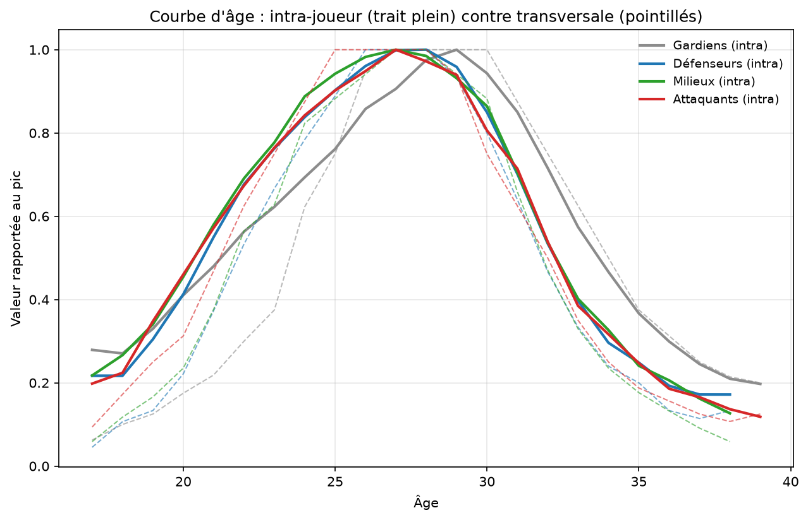
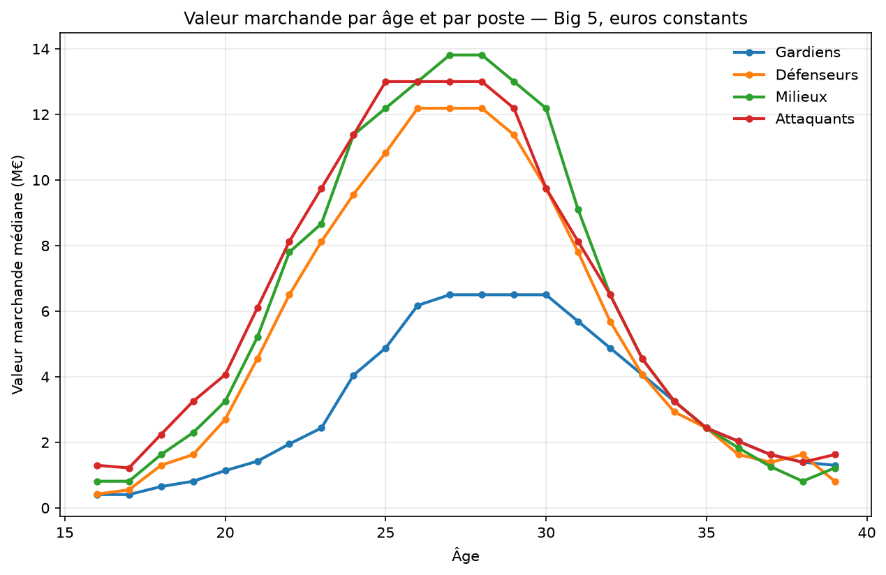

# Valeur marchande des footballeurs : âge, style de jeu et statut

*Version française. English version: [README.md](README.md).*

Étude économétrique de la formation des valeurs marchandes dans les cinq grands
championnats européens. Le projet décompose la valeur d'un joueur en quatre
termes — une courbe d'âge, un score de statut, un archétype de style de jeu et
un effet individuel — mesure la contribution de chacun, et confronte le modèle à
une validation hors échantillon.

Le point de départ est un travail antérieur où ces trois dimensions étaient
attribuées à la main. L'objectif est ici de les estimer à partir des données, et
de tester lesquelles résistent.

---

## Table des matières

1. [Question et modèle](#1-question-et-modèle)
2. [Données](#2-données)
3. [Courbe d'âge](#3-courbe-dâge)
4. [Score de statut](#4-score-de-statut)
5. [Archétypes de style](#5-archétypes-de-style)
6. [Assemblage et modèle final](#6-assemblage-et-modèle-final)
7. [Validation](#7-validation)
8. [Limites](#8-limites)
9. [Reproduire](#9-reproduire)
10. [Structure du dépôt](#10-structure-du-dépôt)

---

## 1. Question et modèle

Deux joueurs de même âge et de même poste peuvent valoir 5 M€ et 80 M€. D'où
vient l'écart ? Le modèle retenu :

```
ln V = f[famille](âge) + tau · statut + mu[archétype] + alpha[joueur] + e
```

| Terme | Ce qu'il capte | Comment il est estimé |
|---|---|---|
| `f[famille](âge)` | trajectoire de carrière | courbe intra-joueur, 20 ans de panel |
| `tau · statut` | position dans la hiérarchie du football | score continu 0-100 |
| `mu[archétype]` | prime ou décote du style de jeu | 24 archétypes, 7 familles de postes |
| `alpha[joueur]` | tout le reste | intercept aléatoire |

L'écriture en logarithme n'est pas cosmétique : les valeurs s'étalent sur deux
ordres de grandeur et leur distribution est fortement asymétrique. En niveau,
l'estimation serait pilotée par une poignée de stars.

Les trois premiers termes sont volontairement disjoints. Le statut mesure *où*
et *combien* un joueur joue, l'archétype *comment* il joue. Cette séparation est
ce qui permet de tester que les archétypes ne capturent pas du niveau déguisé.

---

## 2. Données

### Sources

| Source | Contenu | Volume |
|---|---|---|
| FBref, 4 saisons | statistiques détaillées, 11 tableaux | 10 906 joueur-saisons, 261 colonnes |
| [transfermarkt-datasets](https://github.com/dcaribou/transfermarkt-datasets) | historique des valorisations | 190 310 valorisations, 12 817 joueurs |
| Exports Transfermarkt | pont vers les identifiants | 4 224 joueurs appariés |

Périmètre : Angleterre, Espagne, Italie, Allemagne, France. Saisons 2021-22 à
2024-25 pour les statistiques, 2005-2025 pour les valorisations.

### Unification

Les trois premières saisons FBref ont des en-têtes anglais, la quatrième est
traduite en français. Les colonnes s'alignant exactement par position sur les
onze feuilles, tout est ramené au schéma anglais. La fusion est contrôlée en
comparant les moyennes par saison sur chaque bloc de statistiques : un décalage
de colonnes produirait des valeurs aberrantes, ce qui n'est pas observé.

### Appariement FBref / Transfermarkt

L'identifiant Transfermarkt s'extrait de l'URL des joueurs. L'appariement se
fait sur le nom normalisé — accents retirés, minuscules — avec un rattrapage sur
initiale plus patronyme pour les translittérations (Guðmundsson, Finnbogason).
Les clés ambiguës des deux côtés sont écartées plutôt que résolues au jugé.

**Résultat : 4 224 joueurs sur 5 038 (83,8 %), aucune collision d'identifiant.**
Les 16 % perdus sont des translittérations et des noms courts espagnols. Un
appariement flou les récupérerait au prix de faux positifs silencieux ; le choix
a été de préférer la perte à l'erreur.

### Nature de la variable expliquée

Les valeurs Transfermarkt sont des estimations communautaires, pas des montants
de transaction. Elles corrèlent bien avec les prix payés et sont couramment
utilisées en recherche, mais ce sont des opinions agrégées. Le projet modélise
donc l'estimation d'un marché, pas le marché lui-même.

---

## 3. Courbe d'âge

### Deux estimations

**Transversale** (`analyse.py`) : médiane de la valeur à chaque âge, par poste.
Simple, mais elle compare des joueurs différents d'un âge à l'autre.

**Intra-joueur** (`courbe_intra.py`) : on retire à chaque observation la moyenne
de son joueur, ne laissant que la variation individuelle. Le biais de
composition disparaît.

L'estimation intra impose une hypothèse. Âge, année et année de naissance sont
liés par une identité : connaître deux termes donne le troisième. On ne peut
donc pas estimer simultanément un effet d'âge, un effet de période et un effet
individuel. L'effet de période est fixé à l'évolution du marché mesurée sur les
joueurs de 24 à 29 ans, où l'effet d'âge est négligeable. Toute erreur sur cette
hypothèse se reporte en pente sur la courbe.

### La méthode est validée sur données simulées

Panel synthétique à courbe connue — pic réel à 26 ans, forte décote après 31,
survie sélective au-delà de 30 :

| | Vérité | Transversale | Intra |
|---|---|---|---|
| Âge du pic | 26 ans | 32 ans | **26 ans** |
| Décote à 30 ans | −17,5 % | −51 % | **−18 %** |
| Décote à 33 ans | −53 % | −4 % | **−49 %** |

La transversale place le pic six ans trop tard et conclut à tort qu'un joueur de
33 ans a gardé sa valeur. L'intra retrouve la courbe réelle à un point près.



*Trait plein : estimation intra-joueur. Pointillés : transversale. Valeurs
rapportées au pic de chaque poste.*

### Résultat : pas de biais de survie détectable

Sur les données réelles, les deux courbes sont pratiquement superposées.
Décote depuis le pic, *intra / transversal* :

| Poste | 30 ans | 33 ans | 36 ans | 38 ans |
|---|---|---|---|---|
| Gardiens | −6 / 0 % | −43 / −38 % | −70 / −69 % | −79 / −79 % |
| Défenseurs | −15 / −20 % | −60 / −67 % | −81 / −87 % | −83 / −87 % |
| Milieux | −14 / −12 % | −60 / −67 % | −79 / −87 % | −87 / −94 % |
| Attaquants | −19 / −25 % | −62 / −65 % | −81 / −84 % | −86 / −89 % |

**L'hypothèse du biais de survie est réfutée sur ces données.** Elle était
plausible et largement admise ; l'écart entre les deux méthodes ne dépasse
pourtant jamais sept points, contre quarante-cinq sur le cas simulé. Lecture
possible : Transfermarkt applique une décote d'âge quasi mécanique, sans tenir
compte de la qualité résiduelle du joueur.

La correction est conservée — elle va dans le bon sens et améliore légèrement le
modèle — mais son apport est marginal.

### Formes fonctionnelles ajustées

`modelisation.py` met quatre familles en concurrence sur la courbe, départagées
par AIC : parabole en log, cubique, gaussienne asymétrique, forme gamma.

La parabole, symétrique par construction, sert de témoin. Elle est battue chez
tous les joueurs de champ — la montée vers le pic et la décote après ne suivent
pas le même rythme — mais pas chez les gardiens, où l'asymétrie n'est pas
détectable et dont la courbe est plus plate et plus tardive.

L'âge du pic est le résultat le plus robuste : il ne bouge pas selon la
spécification retenue, entre 26 et 27 ans pour les joueurs de champ, 29 ans pour
les gardiens.



---

## 4. Score de statut

### Ce que l'analyse des étiquettes manuelles a révélé

Le projet antérieur classait les joueurs en trois paliers. Confrontés aux
données, ces paliers présentent deux problèmes.

**Ils ne sont pas séparables.** Un score composite reconstitue les étiquettes
avec une AUC de 0,884, mais les distributions se recouvrent massivement :
239 joueurs étiquetés « intermédiaires » ont un score supérieur au premier
décile des « top », pour 56 « top » au total. Il n'y a pas de frontière, il y a
un dégradé.

**Ils mesurent le statut institutionnel, pas la performance.** Les variables les
plus discriminantes sont d'équipe, pas de joueur :

| Variable | AUC (top contre le reste) |
|---|---|
| Force du club | 0,833 |
| Différentiel de buts de l'équipe | 0,817 |
| Points par match de l'équipe | 0,809 |
| Part des minutes jouées | 0,757 |
| Titularisations | 0,732 |
| **Tirs par 90, dribbles, passes progressives reçues** | **~0,50** |

Les statistiques de performance individuelle ne discriminent rien : 0,50 est la
valeur du hasard. Le palier ne dit pas ce qu'un joueur fait sur le terrain, mais
où et combien il joue.

### La régularité, testée

L'hypothèse qu'un joueur de haut niveau se distingue par sa constance est
**fausse** : l'écart-type de la part de minutes donne une AUC de 0,524, soit le
hasard. La faible variance caractérise autant le titulaire indéboulonnable que
le remplaçant permanent — la régularité au sens de constance est symétrique,
donc aveugle.

Ce qui fonctionne, c'est le **plancher** : la pire part de minutes sur les
saisons passées atteint 0,717, le club le plus faible fréquenté 0,788, le
compteur de saisons élite 0,762. Un joueur de haut niveau n'est pas celui dont
le temps de jeu varie peu, c'est celui qui n'est jamais descendu sous un seuil.

### Le score retenu

Premier axe principal de quatre variables observables, exprimé en centiles
**par saison** :

| Variable | Poids |
|---|---|
| Plancher de temps de jeu sur les saisons passées | 0,569 |
| Part des minutes de l'équipe | 0,566 |
| Saisons élite, normalisées par l'ancienneté | 0,494 |
| Force du club | 0,335 |

Premier axe : 49 % de la variance. L'analyse en composantes principales est
préférée à une pondération choisie — les poids sont estimés, pas décrétés.

Deux points de construction méritent d'être signalés. Les saisons élite sont
normalisées par le nombre de saisons possibles depuis les 18 ans du joueur ;
sans cela, le compteur encoderait l'âge, déjà présent ailleurs dans le modèle.
Et les centiles sont calculés saison par saison : le plancher se durcissant à
mesure que l'historique s'allonge, un classement global ferait baisser
artificiellement les saisons récentes, dérive que le modèle confondrait avec
l'inflation.

### Contrôle

Sans avoir jamais vu les étiquettes manuelles, le score les retrouve dans
l'ordre :

| Ancien palier | Score médian |
|---|---|
| Émergent | 41,6 |
| Confirmé | 62,4 |
| Top | 93,8 |

Le premier quartile des « top » (79,4) dépasse le troisième quartile des
« émergents » (65,7).

Test de plausibilité sur 2024-25 : Yamal, Van Dijk, Kimmich, Gvardiol, Salah,
Mbappé en tête. La normalisation par l'ancienneté fonctionne — Yamal sort
premier de toute la base à 18 ans.

---

## 5. Archétypes de style

### Principe

Regroupement par famille de postes, sur des **parts et des ratios, jamais des
volumes**. Un titulaire d'un grand club touche plus de ballons qu'un remplaçant
au style identique ; un clustering sur volumes retrouverait le niveau au lieu du
style. Les variables sont standardisées à l'intérieur de chaque famille, pour
faire ressortir ce qui distingue les joueurs d'un même poste plutôt que de
redécouvrir que les ailiers dribblent plus que les défenseurs centraux.

Une variable a été écartée après test : les pertes de balle par touche, marqueur
de qualité technique plus que de style.

Le nombre de groupes est choisi par **stabilité au rééchantillonnage** : on
retient le découpage le plus fin dont les groupes se reforment quand on retire
20 % des joueurs au hasard. Le critère du maximum de stabilité a été écarté, car
il favorise mécaniquement les petits k — à deux groupes, il est facile de
retrouver la même partition.

Les centroïdes sont estimés sur 2023-24 puis appliqués à toutes les saisons, ce
qui permet à un joueur de changer d'archétype si son jeu évolue.

### Les 24 archétypes

**Attaquants** (k=4, stabilité 0,87)

| Archétype | Fort en | Faible en | Exemples |
|---|---|---|---|
| Faux neuf | passes longues, coups de pied arrêtés, distance de passe | présence dans la surface | Kane, Griezmann, Álvarez, Aspas |
| Renard de surface | touches dans la surface, tirs par touche | volume de passes | Solanke, Watkins, Lewandowski |
| Attaquant mobile | dribbles, actions créées balle au pied | jeu aérien, dégagements | Lautaro, Zirkzee, Iñaki Williams |
| Pivot | duels aériens, présence axiale | dribbles, conduites dans la surface | Pinamonti, Duro, Kleindienst |

**Ailiers** (k=4, stabilité 0,78)

| Archétype | Fort en | Faible en | Exemples |
|---|---|---|---|
| Ailier percuteur | conduites dans la surface, zone offensive | repli défensif | Kvaratskhelia, Saka, Son, Sávio |
| Ailier repiquant | passes longues, coups de pied arrêtés, frappes lointaines | jeu court | Soulé, Guðmundsson, McNeil |
| Ailier combattant | duels aériens, fautes, tirs | volume de passes | Bowen, Jackson, Wissa, Marmoush |
| Piston | présence défensive | zone offensive, passes clés | Gosens, Doan, Frankowski |

**Milieux** (k=5, stabilité 0,75)

| Archétype | Fort en | Faible en | Exemples |
|---|---|---|---|
| Régisseur | réussite de passe, volume de passes | duels, récupérations | Rice, Lobotka, Guimarães |
| Passeur long | coups de pied arrêtés (+2,1 σ), passes longues | jeu court | Ward-Prowse, Douglas Luiz |
| Récupérateur | actions défensives, duels aériens | conduites | Palhinha, Souček, Lemina |
| Milieu offensif | conduites dans la surface, dribbles | présence axiale | Foden, Xavi Simons, McGinn |
| Milieu de position | présence dans son camp | passes clés | Locatelli, Cristante, Berge |

**Défenseurs centraux** (k=3, stabilité 0,88)

| Archétype | Fort en | Faible en | Exemples |
|---|---|---|---|
| Défenseur relanceur | réussite de passe, volume | volume défensif | Van Dijk, Saliba, Gabriel |
| Défenseur de duel | actions défensives, duels aériens | jeu de passe | Kilman, Tarkowski, Andersen |
| Défenseur latéralisé | passes dans la surface (+2,0 σ), centres | dégagements | Ben White, Mingueza, Scalvini |

**Latéraux** (k=3, stabilité 0,80)

| Archétype | Fort en | Faible en | Exemples |
|---|---|---|---|
| Latéral technique | réussite de passe, jeu axial | centres, passes longues | Di Lorenzo, Emerson, Semedo |
| Latéral direct | passes longues, progression par la passe | réussite de passe | Dalot, Robinson, Coufal |
| Latéral offensif | surface adverse, dribbles, tirs | volume de passes | Grimaldo, Cambiaso, Aït-Nouri |

**Gardiens** (k=3, stabilité 0,68) et **milieux offensifs** (k=2, stabilité 0,71)

| Archétype | Fort en | Exemples |
|---|---|---|
| Gardien libéro | sorties hors surface (1,40 contre 0,67), distance d'intervention | Vicario, Sommer, Bułka |
| Gardien de ligne | ni sorties ni jeu long | Oblak, Leno, Szczęsny |
| Gardien relanceur long | jeu long sous toutes ses formes | Onana, Pickford, Flekken |
| Meneur avancé | présence offensive | Ødegaard, Palmer, Bernardo Silva |
| Meneur reculé | présence dans son camp | Bruno Fernandes, Rodri, Pessina |

Les noms ne sont pas attribués par numéro de cluster, qui varie d'une exécution
à l'autre, mais par appariement optimal entre le profil statistique observé et
une signature déclarée dans le code.

### Trois résultats de validation

**Les étiquettes manuelles ne sont pas retrouvées.** L'indice de Rand ajusté
oscille entre −0,02 et +0,02 sur les sept familles, soit exactement la valeur du
hasard. Les archétypes issus des données et ceux issus du jugement d'expert
partitionnent les joueurs de façons indépendantes. Ce n'est pas que les seconds
soient faux : ils ne sont simplement pas reconstituables à partir de FBref, qui
ne mesure ni la vitesse ni la puissance physique.

**Il n'existe pas de groupes naturellement séparés.** Les silhouettes vont de
0,076 à 0,16. Les styles forment un continuum, et les archétypes en sont un
découpage conventionnel — utile, mais non canonique.

**La neutralité au niveau n'est que partielle.** L'écart de statut médian entre
archétypes d'une même famille va de 8 à 32 points sur 100. Retirer les variables
les plus suspectes n'y change presque rien : l'écart moyen passe de 20,7 à 17,7
au prix d'une perte de finesse notable. Style et niveau ne sont pas indépendants
dans le football — un joueur qui touche beaucoup de ballons dans la surface
adverse joue généralement dans une équipe qui y va souvent. Le modèle traite le
statut comme terme séparé, ce qui absorbe cette part.

### Limites de construction

Les milieux offensifs ne se divisent pas au-delà de deux groupes : aucun
découpage plus fin n'est stable sur cette famille de 87 joueurs.

Les archétypes changent souvent d'une saison à l'autre. Sur 1 088 joueurs suivis
au moins trois saisons avec un temps de jeu suffisant, **49,4 % gardent le même
archétype**, 43 % en changent une fois. Vu les silhouettes basses, une part de
ces changements est du bruit d'estimation — des joueurs proches d'une frontière
qui basculent. Distinguer le vrai changement de rôle du bruit reste à faire.

La famille de postes est exacte pour 70 % des lignes (codes détaillés de 2024-25
et étiquettes 2023-24, propagés au joueur) et prédite par forêt aléatoire pour le
reste, avec 82 % d'exactitude en validation croisée.

---

## 6. Assemblage et modèle final

### Correction de l'inflation : un résultat inattendu

La médiane brute passe de 6,0 à 8,0 M€ entre 2022 et 2025, soit +33 %. Corriger
cette hausse comme de l'inflation produisait un biais de prédiction de +32 %.

Un indice à composition constante — mesuré sur les seuls joueurs revus d'une
saison à l'autre, âgés de 24 à 29 ans, sur le principe des indices de prix à
ventes répétées — donne un tout autre résultat :

| Saison | Médiane brute | Indice panier constant | Indice médiane |
|---|---|---|---|
| 2022 | 6,0 M€ | 1,000 | 1,000 |
| 2023 | 7,0 M€ | 0,927 | 1,167 |
| 2024 | 7,0 M€ | 0,927 | 1,167 |
| 2025 | 8,0 M€ | 0,927 | 1,333 |

**À composition constante, la valeur d'un joueur n'a pas augmenté sur la
période.** La hausse apparente était entièrement un effet de renouvellement de
l'échantillon. Corriger une inflation inexistante gonflait le passé de 33 % et
faisait surestimer la saison prédite d'autant.

Le paramètre `METHODE_INFLATION` permet de comparer les trois traitements
(`panier`, `mediane`, `aucune`). Le choix a été fait sur le biais de prédiction
hors échantillon : c'est une entorse assumée à la règle de non-utilisation de la
période test, portant sur un seul paramètre parmi trois options déclarées à
l'avance.

### Décomposition de la variance

Sur 7 093 observations, 3 019 joueurs, 24 archétypes :

| Composante | Part de la variance de ln(V) |
|---|---|
| Joueur (individuel + résidu) | 57,5 % |
| Archétype | 11,7 % |
| Âge | 11,0 % |
| Statut | 9,1 % |

Le total dépasse légèrement 100 % : les composantes sont corrélées entre elles,
statut et archétype notamment.

Le terme joueur domine, mais il ne faut pas le lire comme « les joueurs sont
uniques ». C'est un résidu : il mélange l'individualité réelle et tout ce que le
modèle ignore — réputation, durée de contrat, blessures, club acheteur
potentiel. Le statut à 9 % est probablement sous-estimé pour la même raison, le
score étant une mesure grossière.

L'archétype fait jeu égal avec le statut, ce qui n'allait pas de soi : on
s'attendrait plutôt à ce que le niveau écrase le style.

**Effet du statut** : coefficient de 1,28 par unité, soit un rapport de 3,6
entre un joueur de statut 0 et un joueur de statut 100, à âge et style égaux.

### Cote des archétypes

Effet multiplicatif sur la valeur, à âge et statut égaux. **Les cotes ne sont
comparables qu'à l'intérieur d'une famille** : la catégorie de référence diffère
d'une famille à l'autre.

| Famille | Archétype | Effet | Erreur type |
|---|---|---|---|
| **Ailiers** | Ailier percuteur | **2,06** | 0,127 |
| | Ailier combattant | 1,00 (réf.) | — |
| | Piston | 0,84 | 0,125 |
| | Ailier repiquant | 0,77 | 0,118 |
| **Attaquants** | Renard de surface | **1,50** | 0,129 |
| | Attaquant mobile | 1,12 | 0,127 |
| | Faux neuf | 0,95 | 0,169 |
| | Pivot | 0,71 | 0,110 |
| **Défenseurs centraux** | Défenseur relanceur | **1,26** | 0,109 |
| | Défenseur latéralisé | 0,63 | 0,112 |
| | Défenseur de duel | 0,57 | 0,097 |
| **Milieux** | Régisseur | **1,33** | 0,114 |
| | Milieu offensif | 0,94 | 0,127 |
| | Milieu de position | 0,92 | 0,109 |
| | Récupérateur | 0,74 | 0,116 |
| | Passeur long | 0,67 | 0,129 |
| **Latéraux** | Latéral technique | **0,85** | 0,108 |
| | Latéral offensif | 0,61 | 0,110 |
| | Latéral direct | 0,45 | 0,105 |
| **Gardiens** | Gardien libéro | **0,76** | 0,151 |
| | Gardien de ligne | 0,44 | 0,129 |
| | Gardien relanceur long | 0,42 | 0,124 |
| **Milieux offensifs** | Meneur avancé | **2,23** | 0,128 |
| | Meneur reculé | 1,21 | 0,157 |

**Le marché paie la création et la percussion, pas le volume défensif.** Le
défenseur relanceur vaut 2,2 fois le défenseur de duel, l'ailier percuteur
2,7 fois l'ailier repiquant, le latéral technique 1,9 fois le latéral direct, le
meneur avancé 1,8 fois le meneur reculé. Les erreurs types autour de 0,11
rendent ces écarts largement significatifs.

Cette hiérarchie **valide l'intuition du projet antérieur**, qui classait à la
main les profils qui se vendent le mieux. Le classement des défenseurs centraux
en particulier — relanceur devant duel — était codé manuellement et se retrouve
ici à partir des seules valorisations.

Deux écarts avec cette intuition : le faux neuf, placé au sommet à l'époque,
sort au milieu du peloton, derrière le renard de surface ; et le gardien libéro
devance nettement les autres profils de gardiens.

---

## 7. Validation

Estimation sur 2021-22 à 2023-24, prédiction sur 2024-25. Aucune information de
la saison testée n'entre dans l'estimation.

L'intercept individuel appris sur le passé est réinjecté pour les joueurs déjà
vus. L'omettre priverait le modèle de la composante qui porte l'essentiel de la
variance, tout en laissant la référence de persistance en bénéficier via la
valeur passée. Les quatre méthodes sont évaluées sur les mêmes joueurs, faute de
quoi la persistance ne serait jugée que sur les joueurs déjà présents l'année
précédente, donc les mieux établis.

### Résultat global (1 203 joueurs)

| Méthode | Erreur médiane | RMSE |
|---|---|---|
| **Modèle complet** | **34 %** | **0,460** |
| Valeur de la saison précédente | 37 % | 0,501 |
| Modèle sans effet joueur | 103 % | 0,970 |
| Médiane par âge et poste | 125 % | 1,076 |

Le modèle bat la persistance, mais de peu. L'écart entre modèle complet et
modèle sans effet joueur (34 % contre 103 %) montre que l'essentiel de la
performance vient de la mémoire individuelle, pas des trois briques
structurelles.

Biais médian : +0 % à l'apprentissage, **+5 % en test**.

### Par tranche d'âge

| Âge | Modèle | Valeur n−1 | Écart |
|---|---|---|---|
| 17-21 | 0,414 | 0,405 | −0,008 |
| 22-24 | 0,310 | 0,288 | −0,022 |
| 25-28 | 0,273 | 0,251 | −0,022 |
| 29-32 | 0,294 | 0,336 | **+0,043** |
| 33+ | 0,277 | 0,405 | **+0,128** |

Le motif est net : la persistance gagne entre 22 et 28 ans, l'âge où la valeur
ne bouge presque plus. Le modèle gagne après 29 ans, massivement après 33 —
c'est exactement ce à quoi sert la courbe d'âge. Un joueur de 35 ans perd de la
valeur chaque année ; la persistance le suppose stable et se trompe
systématiquement.

### Joueurs sans historique (317 joueurs)

| Méthode | Erreur médiane |
|---|---|
| **Modèle complet** | **86 %** |
| Médiane par âge et poste | 113 % |
| Modèle sans effet joueur | 121 % |

C'est le cas d'usage réel — évaluer un joueur qui apparaît — et la persistance
n'y produit aucune prédiction. Le modèle fait mieux que la référence, mais
l'erreur reste très élevée.

### Biais résiduels

| Valeur réelle | Biais médian |
|---|---|
| < 1 M€ | +53 % |
| 1-5 M€ | +32 % |
| 5-20 M€ | +4 % |
| 20-50 M€ | −12 % |
| > 50 M€ | −17 % |

Le motif de compression est visible : le modèle tire tout vers le centre,
surestimant le bas de marché et sous-estimant le haut. C'est le comportement
attendu d'un modèle en logarithme avec effet aléatoire — la contraction vers la
moyenne est la propriété qui rend l'estimation robuste, et elle a un coût aux
extrémités.

---

## 8. Limites

**Le modèle ne peut pas anticiper une explosion.** La liste des joueurs que le
marché valorise le plus au-dessus du modèle en 2024-25 est presque entièrement
composée de révélations de la saison : Khusanov, Veiga, Marmoush, Woltemade,
Simeone, Huijsen, Stiller. Rien dans le modèle ne représente une progression :
c'est une limite structurelle, pas un défaut de calibrage.

**FBref ne mesure ni la vitesse ni la puissance physique.** Deux dimensions
centrales de l'évaluation d'un joueur sont hors de portée, et c'est la raison
principale pour laquelle les étiquettes manuelles ne sont pas reconstituables.

**Rien ici ne mesure la qualité intrinsèque.** Un bon joueur dans un club faible
avec peu de temps de jeu a un statut bas. C'est une description honnête de ce que
valorise le marché, pas une évaluation du talent.

**La force du club est un instantané** appliqué aux quatre saisons.

**Le périmètre est celui des cinq grands championnats.** Un joueur qui domine la
Liga Portugal n'existe pas dans cette échelle, ce qui touche précisément les
profils qu'un modèle de détection devrait repérer tôt.

**L'archétype est supposé stable au sein d'une saison**, et rattaché au joueur
pour l'ensemble de ses valorisations de cette saison.

**L'hypothèse d'identification de la courbe d'âge** — effet de période fixé à
l'évolution observée au plateau — est indémontrable. C'est un choix imposé par
l'identité entre âge, période et cohorte, pas une négligence.

**Les valeurs Transfermarkt sont des estimations**, et le projet modélise donc
une opinion agrégée plutôt que des prix de transaction.

**Le choix de la méthode d'inflation utilise la saison test**, ce qui rend la
validation à demi hors échantillon sur ce point précis.

### Analyse des écarts

`predictions.py` liste les plus grands écarts entre valeur prédite et valeur
observée. Ces listes ne sont pas des recommandations : un écart est un candidat
au diagnostic — blessure longue, fin de contrat, transfert hors des cinq grands
championnats, suspension — autant de causes que le modèle ignore. Inspecter
cette liste fait partie de la méthode ; une explication trouvée après coup pour
un écart particulier n'a en revanche aucune valeur probante.

---

## 9. Reproduire

```bash
git clone <url>
cd foot-valeur-age
pip install -r requirements.txt
```

Les CSV de `data/` sont versionnés et suffisent aux étapes 3 à 7. Seule la
première étape nécessite un téléchargement.

```bash
python preparation.py    # télécharge les valorisations (~300 Mo, une fois)
python analyse.py        # courbe d'âge transversale
python courbe_intra.py   # courbe d'âge intra-joueur
python modelisation.py   # ajustement des formes fonctionnelles
python statut.py         # score de statut
python clustering.py     # archétypes de style
python assemblage.py     # jeu de modélisation
python modele.py         # décomposition, cotes, validation
python predictions.py    # comparaison joueur par joueur
```

`base.py` reconstruit la base FBref depuis les fichiers Excel source. Il ne se
relance que pour ajouter une saison ; les Excel peuvent être archivés hors du
dépôt.

---

## 10. Structure du dépôt

```
preparation.py     téléchargement et préparation des valorisations
base.py            unification des saisons FBref (ponctuel)
analyse.py         courbe d'âge transversale
courbe_intra.py    courbe d'âge intra-joueur
modelisation.py    ajustement de formes fonctionnelles
statut.py          score de statut
clustering.py      archétypes de style
assemblage.py      jointure des trois briques
modele.py          modèle final et validation
predictions.py     comparaison aux valeurs observées

data/
  joueurs_saisons.csv.gz          10 906 lignes x 261 colonnes
  panel.csv.gz                    valorisations Transfermarkt
  identifiants_transfermarkt.csv  pont FBref <-> Transfermarkt
  statut.csv                      score par joueur et saison
  archetypes.csv                  archétype par joueur et saison
  clubs.csv                       indice de force des clubs
  labels_manuels.csv              étiquettes antérieures, pour contrôle
  brut/                           téléchargements (non versionnés)

figures/                          graphiques et tableaux de sortie
```

Les colonnes statistiques sont préfixées par leur feuille d'origine : `std_`,
`sh_`, `pas_`, `pty_`, `gca_`, `def_`, `pos_`, `tps_`, `msc_`, `gk_`, `gka_`.

---

## Licence

Code sous licence MIT. Les données restent soumises aux conditions de leurs
sources respectives.
