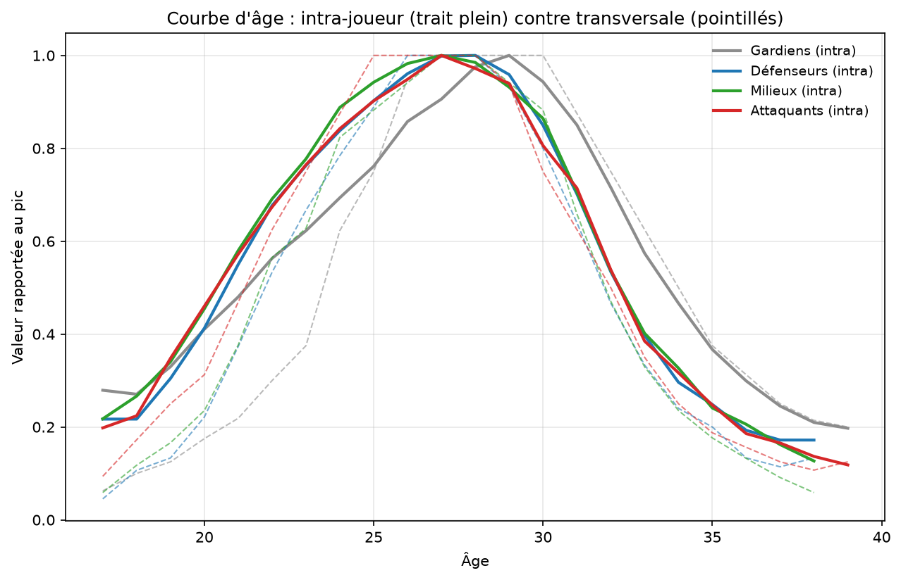
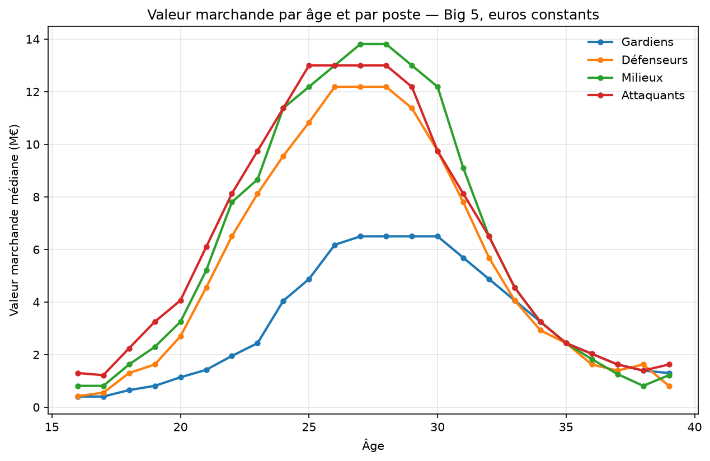

# Football market values: age, playing style and status

An econometric study of how market values form in Europe's five major leagues.
The project decomposes a player's value into four terms — an age curve, a status
score, a playing-style archetype and an individual effect — measures what each
contributes, and puts the model through out-of-sample validation.

The starting point was an earlier project where these three dimensions were
assigned by hand. The goal here is to estimate them from data instead, and find
out which ones survive contact with it.

> **2021–2025 enriched iteration.** The original analysis below is retained as
> version 1. A separate annual dataset of 13,637 player-years now includes
> documented injury absences, contract-source status, estimated Capology salaries
> and multiple-club provenance. Run `iteration_v2.py` with the source workbook
> to reproduce `data/v2/`. See [methods, fields and limitations](docs/iteration_v2.md).
> The experimental version 2 model does not replace the results below: no
> contract expiry is certified as of season end, salary coverage is uneven,
> and the five FBref seasons are not certified exhaustive.

> **A note on language.** This README is in English; the code, column names and
> archetype labels are in French. Football terms such as *faux neuf*,
> *régisseur* and *libéro* are kept in French throughout, including in the
> output files.

---

## Contents

1. [Question and model](#1-question-and-model)
2. [Data](#2-data)
3. [Age curve](#3-age-curve)
4. [Status score](#4-status-score)
5. [Style archetypes](#5-style-archetypes)
6. [Assembly and final model](#6-assembly-and-final-model)
7. [Validation](#7-validation)
8. [Limitations](#8-limitations)
9. [Reproducing](#9-reproducing)
10. [Repository layout](#10-repository-layout)

---

## 1. Question and model

Two players of the same age and position can be worth €5M and €80M. Where does
the gap come from? The model:

```
ln V = f[position group](age) + tau · status + mu[archetype] + alpha[player] + e
```

| Term | What it captures | How it is estimated |
|---|---|---|
| `f[position group](age)` | career trajectory | within-player curve, 20 years of panel data |
| `tau · status` | standing in football's hierarchy | continuous 0-100 score |
| `mu[archetype]` | premium or discount on playing style | 24 archetypes across 7 position groups |
| `alpha[player]` | everything else | random intercept |

Working in logarithms is not cosmetic: values span two orders of magnitude and
their distribution is heavily skewed. In levels, estimation would be driven
entirely by a handful of stars.

The first three terms are deliberately disjoint. Status measures *where* and
*how much* a player plays; the archetype measures *how* he plays. That
separation is what makes it possible to test whether the archetypes are
capturing quality in disguise.

---

## 2. Data

### Sources

| Source | Content | Volume |
|---|---|---|
| FBref, 4 seasons | detailed statistics, 11 tables | 10,906 player-seasons, 261 columns |
| [transfermarkt-datasets](https://github.com/dcaribou/transfermarkt-datasets) | valuation history | 190,310 valuations, 12,817 players |
| Transfermarkt exports | bridge to player IDs | 4,224 players matched |

Scope: England, Spain, Italy, Germany, France. Seasons 2021-22 to 2024-25 for
statistics, 2005-2025 for valuations.

### Unification

The first three FBref seasons have English headers; the fourth is translated
into French. Since columns align exactly by position across all eleven sheets,
everything is mapped back onto the English schema. The merge is checked by
comparing per-season means on each block of statistics: a column shift would
produce obviously wrong values, which is not what we observe.

### FBref / Transfermarkt matching

Transfermarkt IDs are extracted from player URLs. Matching runs on normalised
names — accents stripped, lowercased — with a fallback on initial plus surname
for transliterations (Guðmundsson, Finnbogason). Keys that are ambiguous on
either side are dropped rather than resolved by guesswork.

**Result: 4,224 players out of 5,038 (83.8%), with zero ID collisions.** The
16% lost are transliterations and short Spanish names. Fuzzy matching would
recover most of them at the cost of silent false positives; the choice was to
prefer loss over error.

### What is being explained

Transfermarkt values are community estimates, not transaction amounts. They
correlate well with prices actually paid and are widely used in research, but
they are aggregated opinions. The project therefore models a market's estimate,
not the market itself.

---

## 3. Age curve

### Two estimates

**Cross-sectional** (`analyse.py`): median value at each age, by position.
Simple, but it compares different players from one age to the next.

**Within-player** (`courbe_intra.py`): each observation has its own player's
mean subtracted, leaving only individual variation. Composition bias disappears.

The within-player estimate requires an assumption. Age, calendar year and birth
year are linked by an identity — any two give the third — so age, period and
individual effects cannot all be estimated at once. The period effect is
therefore imposed: it is fixed to the market movement observed among players
aged 24 to 29, where the age effect is negligible. Any error in that assumption
translates into slope on the age curve.

### The method is validated on simulated data

Synthetic panel with a known curve — true peak at 26, steep decline after 31,
selective survival past 30:

| | Truth | Cross-sectional | Within-player |
|---|---|---|---|
| Peak age | 26 | 32 | **26** |
| Decline at 30 | −17.5% | −51% | **−18%** |
| Decline at 33 | −53% | −4% | **−49%** |

The cross-sectional method puts the peak six years too late and wrongly
concludes that a 33-year-old has held his value. The within-player estimate
recovers the true curve to within a point.



*Solid lines: within-player estimate. Dashed: cross-sectional. Values are
relative to each position's peak.*

### Result: no detectable survivorship bias

On real data, the two curves are essentially on top of each other. Decline from
peak, *within-player / cross-sectional*:

| Position | Age 30 | Age 33 | Age 36 | Age 38 |
|---|---|---|---|---|
| Goalkeepers | −6 / 0% | −43 / −38% | −70 / −69% | −79 / −79% |
| Defenders | −15 / −20% | −60 / −67% | −81 / −87% | −83 / −87% |
| Midfielders | −14 / −12% | −60 / −67% | −79 / −87% | −87 / −94% |
| Forwards | −19 / −25% | −62 / −65% | −81 / −84% | −86 / −89% |

**The survivorship hypothesis is refuted on this data.** It was plausible and
widely assumed; yet the gap between methods never exceeds seven points, against
forty-five on the simulated case. One reading: Transfermarkt applies an almost
mechanical age discount, without regard for a player's residual quality.

The correction is kept — it points the right way and marginally improves the
model — but its contribution is small.

### Functional forms

`modelisation.py` pits four families against each other on the curve, ranked by
AIC: log-quadratic, cubic, asymmetric Gaussian, gamma shape.

The parabola, symmetric by construction, serves as a control. It is beaten for
all outfield players — the climb to the peak and the decline afterwards do not
follow the same rhythm — but not for goalkeepers, where no asymmetry is
detectable and whose curve is flatter and later.

Peak age is the most robust finding: it does not move with the specification —
26 to 27 for outfield players, 29 for goalkeepers.



---

## 4. Status score

### What analysing the manual labels revealed

The earlier project sorted players into three tiers. Confronted with the data,
those tiers have two problems.

**They are not separable.** A composite score reconstructs the labels with an
AUC of 0.884, but the distributions overlap massively: 239 players labelled
"intermediate" score above the first decile of the "top" group, against only 56
"top" players in total. There is no boundary, there is a gradient.

**They measure institutional standing, not performance.** The most
discriminating variables are team-level, not player-level:

| Variable | AUC (top vs rest) |
|---|---|
| Club strength | 0.833 |
| Team goal difference | 0.817 |
| Team points per match | 0.809 |
| Share of team minutes played | 0.757 |
| Starts | 0.732 |
| **Shots per 90, dribbles, progressive passes received** | **~0.50** |

Individual performance statistics discriminate nothing: 0.50 is chance. The tier
does not say what a player does on the pitch, but where and how much he plays.

### Consistency, tested

The hypothesis that elite players stand out through consistency is **false**:
the standard deviation of minutes share gives an AUC of 0.524, i.e. chance. Low
variance describes the undroppable starter and the permanent substitute equally
well — consistency in the sense of steadiness is symmetric, and therefore blind.

What works is the **floor**: worst minutes share across past seasons reaches
0.717, weakest club played for 0.788, elite-season counter 0.762. An elite player
is not one whose playing time varies little, but one who has never dropped below
a threshold.

### The score

First principal component of four observable variables, expressed as
**per-season** percentiles:

| Variable | Loading |
|---|---|
| Floor of playing time across past seasons | 0.569 |
| Share of team minutes | 0.566 |
| Elite seasons, normalised by seniority | 0.494 |
| Club strength | 0.335 |

First component: 49% of variance. PCA is preferred to hand-chosen weights — the
loadings are estimated, not decreed.

Two construction details are worth flagging. Elite seasons are normalised by the
number of seasons possible since the player turned 18; without that, the counter
would encode age, which is already elsewhere in the model. And percentiles are
computed season by season: since the floor hardens as history accumulates, a
global ranking would artificially depress recent seasons — drift the model would
mistake for inflation.

### Control

Without ever seeing the manual labels, the score recovers their ordering:

| Old tier | Median score |
|---|---|
| Emerging | 41.6 |
| Established | 62.4 |
| Top | 93.8 |

The first quartile of "top" (79.4) sits above the third quartile of "emerging"
(65.7).

Plausibility check on 2024-25: Yamal, Van Dijk, Kimmich, Gvardiol, Salah, Mbappé
at the top. The seniority normalisation works — Yamal comes out first in the
entire database at 18.

---

## 5. Style archetypes

### Principle

Clustering within each position group, on **shares and ratios, never volumes**.
A starter at a big club touches the ball more than a substitute with identical
style; clustering on volumes would recover quality instead of style. Variables
are standardised within each position group, so that what emerges is what
separates players in the same role — rather than rediscovering that wingers
dribble more than centre-backs.

One variable was dropped after testing: turnovers per touch, which marks
technical quality more than style.

The number of groups is chosen by **resampling stability**: the finest partition
whose groups reform when 20% of players are dropped at random. Maximum stability
was rejected as a criterion because it mechanically favours small k — with two
groups it is easy to recover the same partition.

Centroids are estimated on 2023-24 and then applied to every season, so a player
can change archetype if his game changes.

### The 24 archetypes

**Forwards** (k=4, stability 0.87)

| Archetype | Strong in | Weak in | Examples |
|---|---|---|---|
| Faux neuf | long passes, set pieces, pass distance | box presence | Kane, Griezmann, Álvarez, Aspas |
| Renard de surface (poacher) | touches in the box, shots per touch | passing volume | Solanke, Watkins, Lewandowski |
| Attaquant mobile | dribbles, chances created on the ball | aerial duels, clearances | Lautaro, Zirkzee, Iñaki Williams |
| Pivot (target man) | aerial duels, central presence | dribbles, carries into the box | Pinamonti, Duro, Kleindienst |

**Wingers** (k=4, stability 0.78)

| Archetype | Strong in | Weak in | Examples |
|---|---|---|---|
| Ailier percuteur (dribbler) | carries into the box, final third | defensive work | Kvaratskhelia, Saka, Son, Sávio |
| Ailier repiquant (inverted) | long passes, set pieces, long-range shots | short passing | Soulé, Guðmundsson, McNeil |
| Ailier combattant (physical) | aerial duels, fouls, shots | passing volume | Bowen, Jackson, Wissa, Marmoush |
| Piston (wing-back) | defensive presence | final third, key passes | Gosens, Doan, Frankowski |

**Midfielders** (k=5, stability 0.75)

| Archetype | Strong in | Weak in | Examples |
|---|---|---|---|
| Régisseur (deep playmaker) | pass completion, passing volume | duels, recoveries | Rice, Lobotka, Guimarães |
| Passeur long | set pieces (+2.1 σ), long passes | short passing | Ward-Prowse, Douglas Luiz |
| Récupérateur (destroyer) | defensive actions, aerial duels | carries | Palhinha, Souček, Lemina |
| Milieu offensif | carries into the box, dribbles | central presence | Foden, Xavi Simons, McGinn |
| Milieu de position (holder) | presence in own half | key passes | Locatelli, Cristante, Berge |

**Centre-backs** (k=3, stability 0.88)

| Archetype | Strong in | Weak in | Examples |
|---|---|---|---|
| Défenseur relanceur (ball-playing) | pass completion, passing volume | defensive volume | Van Dijk, Saliba, Gabriel |
| Défenseur de duel (stopper) | defensive actions, aerial duels | passing | Kilman, Tarkowski, Andersen |
| Défenseur latéralisé (wide) | passes into the box (+2.0 σ), crosses | clearances | Ben White, Mingueza, Scalvini |

**Full-backs** (k=3, stability 0.80)

| Archetype | Strong in | Weak in | Examples |
|---|---|---|---|
| Latéral technique | pass completion, inside play | crosses, long passes | Di Lorenzo, Emerson, Semedo |
| Latéral direct | long passes, progressive distance | pass completion | Dalot, Robinson, Coufal |
| Latéral offensif | opposition box, dribbles, shots | passing volume | Grimaldo, Cambiaso, Aït-Nouri |

**Goalkeepers** (k=3, stability 0.68) and **attacking midfielders** (k=2,
stability 0.71)

| Archetype | Strong in | Examples |
|---|---|---|
| Gardien libéro (sweeper) | actions outside the box (1.40 vs 0.67), distance from goal | Vicario, Sommer, Bułka |
| Gardien de ligne (shot-stopper) | neither sweeping nor long distribution | Oblak, Leno, Szczęsny |
| Gardien relanceur long | long distribution of every kind | Onana, Pickford, Flekken |
| Meneur avancé (advanced playmaker) | attacking presence | Ødegaard, Palmer, Bernardo Silva |
| Meneur reculé (deep playmaker) | presence in own half | Bruno Fernandes, Rodri, Pessina |

Names are not assigned by cluster number, which varies between runs, but by
optimal matching between the observed statistical profile and a signature
declared in the code.

### Three validation findings

**The manual labels are not recovered.** Adjusted Rand index ranges from −0.02
to +0.02 across the seven position groups — exactly chance. Data-driven
archetypes and expert-judgement archetypes partition players independently. That
does not make the latter wrong: they simply cannot be reconstructed from FBref,
which measures neither pace nor physicality.

**There are no naturally separated groups.** Silhouette scores range from 0.076
to 0.16. Styles form a continuum, and the archetypes are a conventional
partition of it — useful, but not canonical.

**Neutrality with respect to quality is only partial.** The gap in median status
between archetypes within a position group runs from 8 to 32 points out of 100.
Removing the most suspect variables barely helps: mean gap falls from 20.7 to
17.7 at a real cost in granularity. Style and quality are not independent in
football — a player who touches the ball often in the opposition box usually
plays for a team that gets there often. The model treats status as a separate
term, which absorbs that share.

### Construction limits

Attacking midfielders do not split beyond two groups: no finer partition is
stable on this group of 87 players.

Archetypes change often between seasons. Among 1,088 players tracked over at
least three seasons with enough playing time, **49.4% keep the same archetype**
and 43% change once. Given the low silhouettes, some of that is estimation noise
— players near a boundary flipping. Separating genuine role change from noise
remains to be done.

Position group is exact for 70% of rows (detailed 2024-25 codes and 2023-24
labels, propagated to the player) and predicted by random forest for the rest,
at 82% cross-validated accuracy.

---

## 6. Assembly and final model

### Inflation correction: an unexpected finding

The raw median rises from €6.0M to €8.0M between 2022 and 2025, a 33% increase.
Treating that rise as inflation produced a +32% prediction bias.

A constant-composition index — measured only on players observed in consecutive
seasons, aged 24 to 29, on the repeat-sales principle — tells a different story:

| Season | Raw median | Constant-basket index | Median index |
|---|---|---|---|
| 2022 | €6.0M | 1.000 | 1.000 |
| 2023 | €7.0M | 0.927 | 1.167 |
| 2024 | €7.0M | 0.927 | 1.167 |
| 2025 | €8.0M | 0.927 | 1.333 |

**At constant composition, player values did not rise over the period.** The
apparent increase was entirely a squad-turnover effect. Correcting for
non-existent inflation inflated the past by 33% and overshot the predicted
season by the same amount.

The `METHODE_INFLATION` parameter allows comparing the three treatments
(`panier`, `mediane`, `aucune`). The choice was made on out-of-sample prediction
bias: an acknowledged departure from the rule against using the test period,
covering a single parameter among three options declared in advance.

### Variance decomposition

Over 7,093 observations, 3,019 players, 24 archetypes:

| Component | Share of variance in ln(V) |
|---|---|
| Player (individual + residual) | 57.5% |
| Archetype | 11.7% |
| Age | 11.0% |
| Status | 9.1% |

The total slightly exceeds 100% because the components are correlated —
particularly status and archetype.

The player term dominates, but it should not be read as "players are unique". It
is a residual: it mixes genuine individuality with everything the model ignores
— reputation, contract length, injuries, likely buying club. Status at 9% is
probably understated for the same reason, the score being a coarse measure.

Archetype matches status, which was not obvious: one would expect quality to
dwarf style.

**Status effect**: coefficient of 1.28 per unit, i.e. a ratio of 3.6 between a
player at status 0 and one at status 100, holding age and style constant.

### Archetype premiums

Multiplicative effect on value, holding age and status constant. **Premiums are
only comparable within a position group**: the reference category differs from
one group to the next.

| Group | Archetype | Effect | Std. error |
|---|---|---|---|
| **Wingers** | Ailier percuteur | **2.06** | 0.127 |
| | Ailier combattant | 1.00 (ref.) | — |
| | Piston | 0.84 | 0.125 |
| | Ailier repiquant | 0.77 | 0.118 |
| **Forwards** | Renard de surface | **1.50** | 0.129 |
| | Attaquant mobile | 1.12 | 0.127 |
| | Faux neuf | 0.95 | 0.169 |
| | Pivot | 0.71 | 0.110 |
| **Centre-backs** | Défenseur relanceur | **1.26** | 0.109 |
| | Défenseur latéralisé | 0.63 | 0.112 |
| | Défenseur de duel | 0.57 | 0.097 |
| **Midfielders** | Régisseur | **1.33** | 0.114 |
| | Milieu offensif | 0.94 | 0.127 |
| | Milieu de position | 0.92 | 0.109 |
| | Récupérateur | 0.74 | 0.116 |
| | Passeur long | 0.67 | 0.129 |
| **Full-backs** | Latéral technique | **0.85** | 0.108 |
| | Latéral offensif | 0.61 | 0.110 |
| | Latéral direct | 0.45 | 0.105 |
| **Goalkeepers** | Gardien libéro | **0.76** | 0.151 |
| | Gardien de ligne | 0.44 | 0.129 |
| | Gardien relanceur long | 0.42 | 0.124 |
| **Attacking mids** | Meneur avancé | **2.23** | 0.128 |
| | Meneur reculé | 1.21 | 0.157 |

**The market pays for creation and penetration, not defensive volume.** A
ball-playing centre-back is worth 2.2 times a stopper; a dribbling winger 2.7
times an inverted one; a technical full-back 1.9 times a direct one; an advanced
playmaker 1.8 times a deep one. Standard errors around 0.11 make these gaps
comfortably significant.

This hierarchy **confirms the earlier project's intuition**, which ranked by hand
the profiles that sell best. The centre-back ordering in particular — ball-player
ahead of stopper — was hand-coded then, and reappears here from valuations alone.

Two departures from that intuition: the *faux neuf*, placed at the top back then,
lands mid-pack behind the poacher; and the sweeper-keeper clearly outranks the
other goalkeeper profiles.

---

## 7. Validation

Estimated on 2021-22 to 2023-24, predicting 2024-25. No information from the
test season enters estimation.

The individual intercept learned on past seasons is fed back in for players
already seen. Omitting it would strip the model of the component carrying most
of the variance while letting the persistence baseline benefit from it through
past value. All four methods are evaluated on the same players — otherwise
persistence would only be judged on players already present the year before,
i.e. the most established ones.

### Overall (1,203 players)

| Method | Median error | RMSE |
|---|---|---|
| **Full model** | **34%** | **0.460** |
| Previous season's value | 37% | 0.501 |
| Model without player effect | 103% | 0.970 |
| Median by age and position | 125% | 1.076 |

The model beats persistence, but narrowly. The gap between full model and model
without player effect (34% vs 103%) shows that most of the performance comes
from individual memory, not from the three structural blocks.

Median bias: +0% in-sample, **+5% out-of-sample**.

### By age band

| Age | Model | Value n−1 | Gap |
|---|---|---|---|
| 17-21 | 0.414 | 0.405 | −0.008 |
| 22-24 | 0.310 | 0.288 | −0.022 |
| 25-28 | 0.273 | 0.251 | −0.022 |
| 29-32 | 0.294 | 0.336 | **+0.043** |
| 33+ | 0.277 | 0.405 | **+0.128** |

The pattern is clear: persistence wins between 22 and 28, the age at which value
barely moves. The model wins after 29, and decisively after 33 — which is
exactly what the age curve is for. A 35-year-old loses value every year;
persistence assumes he is stable and is wrong systematically.

### Players without history (317 players)

| Method | Median error |
|---|---|
| **Full model** | **86%** |
| Median by age and position | 113% |
| Model without player effect | 121% |

This is the real use case — valuing a player who appears — and persistence
produces no prediction at all. The model beats the baseline, but the error
remains very large.

### Residual bias

| Actual value | Median bias |
|---|---|
| < €1M | +53% |
| €1-5M | +32% |
| €5-20M | +4% |
| €20-50M | −12% |
| > €50M | −17% |

The compression pattern is visible: the model pulls everything toward the
centre, overestimating the low end and underestimating the high end. That is
expected behaviour for a log model with a random effect — shrinkage toward the
mean is the property that makes estimation robust, and it has a cost at the
extremes.

---

## 8. Limitations

**The model cannot anticipate a breakout.** The players the market values most
above the model in 2024-25 are almost all breakout stories of that season:
Khusanov, Veiga, Marmoush, Woltemade, Simeone, Huijsen, Stiller. Nothing in the
model represents progression — a structural limit, not a calibration flaw.

**FBref measures neither pace nor physicality.** Two central dimensions of
player evaluation are out of reach, and this is the main reason the manual
labels cannot be reconstructed.

**Nothing here measures intrinsic quality.** A good player at a weak club with
little playing time gets a low status. That is an honest description of what the
market rewards, not an assessment of talent.

**Club strength is a single snapshot** applied to all four seasons.

**Scope is the big five leagues.** A player dominating the Portuguese league does
not exist on this scale — precisely the profile a scouting model should catch
early.

**Archetype is assumed stable within a season** and attached to the player for
all of that season's valuations.

**The age curve's identifying assumption** — period effect fixed to the movement
observed on the plateau — is untestable. It is forced by the identity linking
age, period and cohort, not an oversight.

**Transfermarkt values are estimates**, so the project models an aggregated
opinion rather than transaction prices.

**The inflation method was chosen using the test season**, which makes validation
half out-of-sample on that specific point.

### Reading the residuals

`predictions.py` lists the largest gaps between predicted and observed value.
These lists are not recommendations: a gap is a candidate for diagnosis — long
injury, expiring contract, transfer outside the big five, suspension — all
causes the model ignores. Inspecting the list is part of the method; an
explanation found after the fact for one particular gap carries no evidential
weight.

---

## 9. Reproducing

```bash
git clone <url>
cd foot-valeur-age
pip install -r requirements.txt
```

The CSVs in `data/` are version-controlled and cover steps 3 to 7. Only the
first step requires a download.

```bash
python preparation.py    # downloads valuations (~300 MB, once)
python analyse.py        # cross-sectional age curve
python courbe_intra.py   # within-player age curve
python modelisation.py   # functional form fitting
python statut.py         # status score
python clustering.py     # style archetypes
python assemblage.py     # modelling dataset
python modele.py         # decomposition, premiums, validation
python predictions.py    # player-by-player comparison
```

`base.py` rebuilds the FBref database from the source Excel files. It only needs
rerunning to add a season; the Excel files can be archived outside the repo.

---

## 10. Repository layout

```
preparation.py     download and prepare valuations
base.py            unify FBref seasons (one-off)
analyse.py         cross-sectional age curve
courbe_intra.py    within-player age curve
modelisation.py    functional form fitting
statut.py          status score
clustering.py      style archetypes
assemblage.py      join the three blocks
modele.py          final model and validation
predictions.py     comparison against observed values

data/
  joueurs_saisons.csv.gz          10,906 rows x 261 columns
  panel.csv.gz                    Transfermarkt valuations
  identifiants_transfermarkt.csv  FBref <-> Transfermarkt bridge
  statut.csv                      status score by player and season
  archetypes.csv                  archetype by player and season
  clubs.csv                       club strength index
  labels_manuels.csv              earlier manual labels, for control
  brut/                           downloads (not version-controlled)

figures/                          plots and output tables
```

Statistical columns are prefixed by their source sheet: `std_`, `sh_`, `pas_`,
`pty_`, `gca_`, `def_`, `pos_`, `tps_`, `msc_`, `gk_`, `gka_`.

A French version of this document is available in
[README.fr.md](README.fr.md).

---

## Licence

Code under MIT licence. Data remain subject to the terms of their respective
sources.
